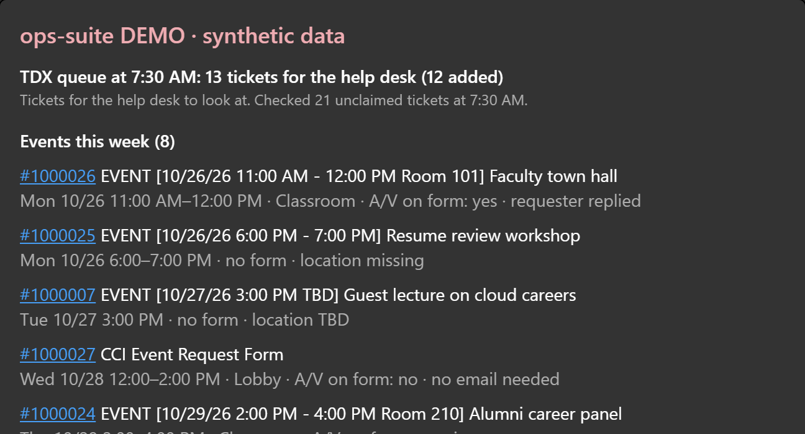

The sky follows the time in Philadelphia. Pick a time of day, or peek at level 10.

How the sky islands work

An animated banner that grows with my GitHub activity, redrawn every hour from my public stats
and the time of day in Philadelphia. Hand-built SVG from Python, no images.

- Each public repo is a building that upgrades with its commits; the newest one is under
  construction.
- Contributions are XP. Islands unlock as I level up: the city, the stadium, then Starport and
  Sky Shrine at levels 6 and 8.
- The train gains coaches, cargo and an observation dome as I level up, and carries wheat,
  wood, stone and crystals earned from my stats.
- The sky follows Philadelphia's weather and Philly game days, and the islands dress up for
  holidays.
- A companion evolves at levels 5 and 10, a dragon flies over on a 7-day streak, and a
  starfighter squadron grows with merged pull requests.

A GitHub Action redraws everything every hour, so there is no server. The rules are in
<a href="docs/DESIGN.md">docs/DESIGN.md</a>.

### Hi, I'm Kevin

I'm a computer science student at Drexel and a student assistant on the IT service desk. I
build AI and automation tools for help desk work, mostly in Python. They handle real student
data, so they stay read-only, use plain rules before any AI, and show their sources.

### Featured projects

<table>
<tr>
<td width="50%" valign="top">

<h4><a href="https://github.com/kevfang03/tdx-queue-auditor">TDX queue auditor</a></h4>
Checks a help desk's ticket queue for stale and stuck tickets with plain, testable rules, then
posts a shift summary card to the desk's Teams chat. Read-only, and no AI unless you turn it on.
 Python · Playwright · Teams Workflows · optional Claude API
</td>
<td width="50%" valign="top">

<h4><a href="https://github.com/kevfang03/scis-help-assistant">SCIS help assistant</a></h4>
A chat assistant that answers students' IT questions from public support pages, cites every
page it used, and says so when a question isn't covered instead of guessing.
 Python · FastAPI · hybrid search (BM25 + embeddings) · Claude API
</td>
</tr>
</table>
