  

## Sky islands

An animated banner that grows with my GitHub activity. Hand-built SVG from Python, no images.

- Islands for the town, the city, the stadium, the wild side and a hilltop server farm.
  Starport and Sky Shrine unlock at levels 6 and 8.
- The sky train gains coaches, cargo and an observation dome as I level up, and
  carries wheat, wood, stone and crystals earned from my stats.
- A companion that evolves at levels 5 and 10, a dragon flyover on a 7-day streak,
  and a starfighter squadron for merged pull requests.

The banner above is drawn from sample data for now. Live stats are next.

Draw it yourself: <code>uv run python -m sky_islands demo --phase dusk</code>.
The rules are in <a href="docs/DESIGN.md">docs/DESIGN.md</a>.
