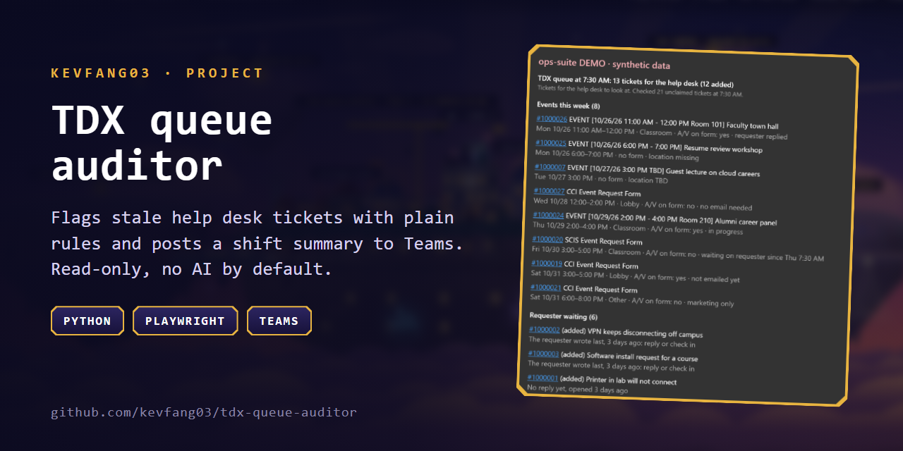
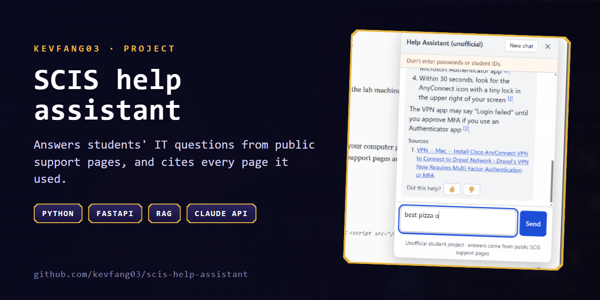

The sky follows the time in Philadelphia. Pick a time of day, or peek at level 10.

### Hi, I'm Kevin

I study computer science and work on a university IT service desk, so I build the tools I
wish the desk had: automation that takes the repetitive work off people and is safe to point
at real student data. Read-only access, plain rules before any AI, and answers that show
their sources.

### Featured projects

<table>
<tr>
<td width="50%" valign="top">

<h4><a href="https://github.com/kevfang03/tdx-queue-auditor">TDX queue auditor</a></h4>
Checks a help desk's ticket queue for stale and stuck tickets with plain, testable rules, then
posts a shift summary card to the desk's Teams chat. Read-only, and no AI unless you turn it on.
 Python · Playwright · Teams Workflows · optional Claude API
</td>
<td width="50%" valign="top">

<h4><a href="https://github.com/kevfang03/scis-help-assistant">SCIS help assistant</a></h4>
A chat assistant that answers students' IT questions from public support pages, cites every
page it used, and says so when a question isn't covered instead of guessing.
 Python · FastAPI · hybrid search (BM25 + embeddings) · Claude API
</td>
</tr>
</table>

How the sky islands work

An animated banner that grows with my GitHub activity, redrawn every hour from my public stats
and the time of day in Philadelphia. Hand-built SVG from Python, no images.

- Each public repo is a building that upgrades with its commits; the newest one is under
  construction.
- Contributions are XP. Islands unlock as I level up: the city, the stadium, then Starport and
  Sky Shrine at levels 6 and 8.
- The sky train gains coaches, cargo and an observation dome as I level up, and carries wheat,
  wood, stone and crystals earned from my stats.
- A companion evolves at levels 5 and 10, a dragon flies over on a 7-day streak, and a
  starfighter squadron grows with merged pull requests.

A GitHub Action redraws everything every hour, so there is no server. The rules are in
<a href="docs/DESIGN.md">docs/DESIGN.md</a>.

