What my world will look like at level 10: the city, the stadium, Starport and Sky Shrine unlocked, a 7-day streak for the dragon and three starfighters at the Starport. My repos are the real ones.

<a href="https://github.com/kevfang03">&larr; Back to my profile</a>

